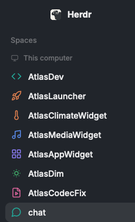

# Space Glyphs

Replaces the colored first-letter tiles of Herdr's space list and its Go to... search with colored line glyphs picked from each space's name, so spaces that share a prefix, like `AtlasDev` and `AtlasLauncher`, stop looking alike. `AtlasLauncher` gets a rocket, `AtlasClimateWidget` a thermometer, `chat` a speech bubble.

## What you see

- **Spaces list, sidebar:** each top-level row starts with a 16px Lucide line glyph, centered in the 18px box the tile used. There is no tile behind it. Name, git tail, row height (30px) and selection are Herdr's.
- **Glyph color:** the space's stored color from shared `space.colors`, the same colors the tiles used: `ansi6` `#22a99a`, `ansi3` `#e3814f`, `ansi4` `#5b8def`, `ansi5` `#8b7cf6`, `ansi2` `#3fae6a`, `ansi1` `#d9649a`.
- **Go to... search:** each space's header row has the same glyph in the same 18px box, before the space name in 11px dim text.
- **Unchanged:** worktree rows keep their branch icon, and the narrow sidebar rail keeps its numbers and status dots.

## How it behaves

- **Picking a glyph:** the name is split on case changes and non-alphanumerics, lowercased, and the word `atlas` is dropped. The first rule in the table with a matching word wins, so specific rules sit above generic ones. A name matching nothing gets a glyph from a pool of 16 by FNV-1a hash of the full name, which stays the same between starts. Two unmatched names can share a glyph. `~` is a house.
- **Examples:** `AtlasMediaWidget` is `music`, `AtlasMediaApi` is `plug`, `AtlasAppWidget` is `layout-grid`, `AtlasAppWindow` is `app-window`, `AtlasTerminal` is `terminal`, `AtlasDim` is `sun-dim`, `AtlasUtils` is `wrench`, `homeserver` is `server`.
- **Agent status:** working, blocked, done and idle don't change the glyph. The list and search show them as Herdr does: in search, a ring for idle and a spinner for working.
- **Clicks and keys:** as in Herdr: click a row to switch, right-click for its menu, drag to reorder. `cmd-p` and the sidebar's search button open the search.
- **Renaming a space** changes its glyph if the new name picks another one.
- **After a Herdr update:** on its next start `spaces-glyph` rebuilds all three mods from the new shipped ones. If an edit no longer fits, that mod stays as it was and a warning notification names it.

## Built from

Three mods, each a clone of a shipped mod with small edits:

- `mods/spaces-glyph` (from `spaces`): imports `glyphPath`, swaps the tile for `svg(glyphPath(w.name)).size(16).text_color(fill)`, and calls `startSync(cx)` in `init`. Own files: `glyphs.js` (`RULES`, `POOL`, `glyphName`, `glyphPath`), `glyphs/*.svg` (Lucide 0.460.0, `stroke="currentColor"`), `start-sync.js`, `sync.mjs`.
- `mods/picker-glyph` (from `picker`): the same swap with `spaceColor(t, r.w)`, and a copy of `glyphs.js`.
- `mods/workspace-chrome-glyph` (from `workspace-chrome`): its search button runs `mod.open` with `picker-glyph`.

`sync.mjs` holds these edits as before/after strings. When `herdr-app --version` differs from `data/space-glyphs-sync.json`, or with `--force`, it applies them to the shipped mods, rewrites `mods/<from>/` asset paths, and writes `spaces-glyph` last. `start-sync.js` runs it with `exec` and passes its notice to `notify`.

To use it, keep your layout and point its blocks at the copies: `content.mod` `spaces` becomes `spaces-glyph`, and every `workspace-chrome` becomes `workspace-chrome-glyph`. Shipped layouts can't be edited, so clone yours first with `layout.clone`. Merge `keys.json` for `cmd-p`.

Programs it runs: `node` and `herdr-app --version`. It uses no network. It reads the shipped `spaces`, `picker` and `workspace-chrome` mods and writes the three copies and `data/space-glyphs-sync.json`.

## Watch out

- Mods can't import across folders (`resolves outside the application directory`), so `picker-glyph` needs its own `glyphs.js`. After editing `RULES`, run `node ~/.config/herdr-app/mods/spaces-glyph/sync.mjs --force` to copy it over.
- A rule's glyph needs its svg in `mods/spaces-glyph/glyphs/`. Only the glyphs in `RULES` and `POOL` are included.
- Folder names are fixed: `sync.mjs` and the glyph paths expect exactly these three names.
- `node` and `herdr-app` must be on the `PATH` mods see. Without them the glyphs still draw but the copies stop updating, possibly with no notification.
- A failed edit shows its warning once and records the new version, so it won't retry until `--force` or the next update.
- Copies are rewritten on updates, so change them by editing the lists in `sync.mjs`, not `main.js`.
- The rules are English words for dev projects. A name in another language gets a pool glyph, and `atlas` is ignored because of the projects this was built for: edit `IGNORED` for your own shared prefix.
- `cmd-p` is a macOS key. Other shipped entry points to the stock picker, such as the Terminals layout's space chip, keep the letter tiles.
- The main.js files are from Herdr 0.1.11. On another version, `sync.mjs` rebuilds them at the first start.

## Done when

- `herdr-app check` passes for all three mods.
- Spaces named `AtlasClimateWidget`, `AtlasMediaApi` and `chat` show a thermometer, a plug and a speech bubble with no tile, each in that space's color.
- `cmd-p` and the sidebar's search button open Go to... with the same glyphs in its space headers.
- `node mods/spaces-glyph/sync.mjs --force` leaves all three `main.js` files unchanged and prints `{}`.
- Changing the shipped `init(_props, cx) {` in a scratch copy and rerunning prints a warning naming `spaces-glyph`, and its `main.js` stays as it was.
